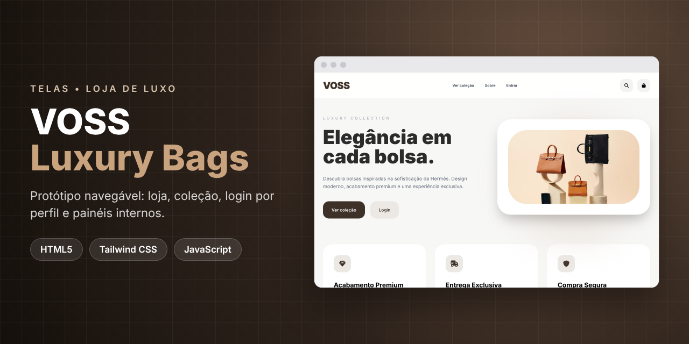
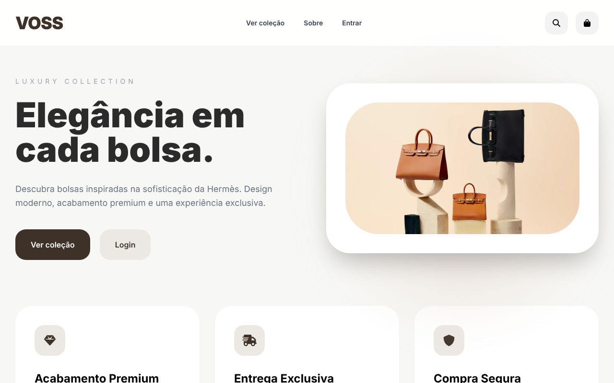
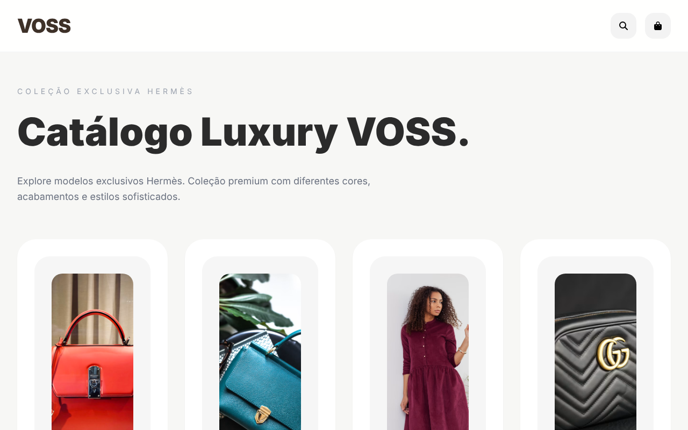
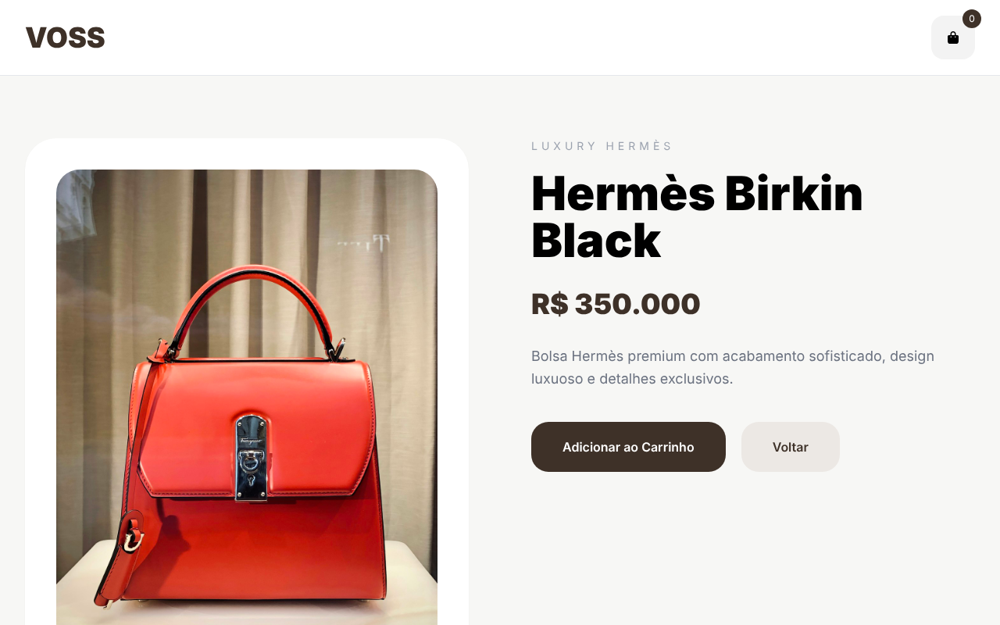
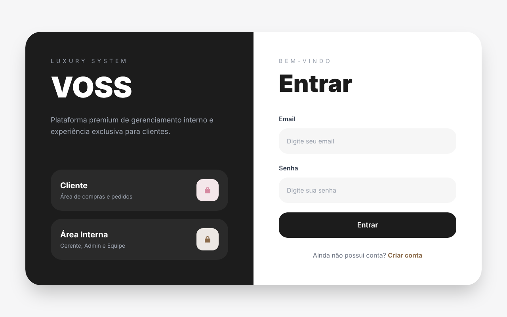
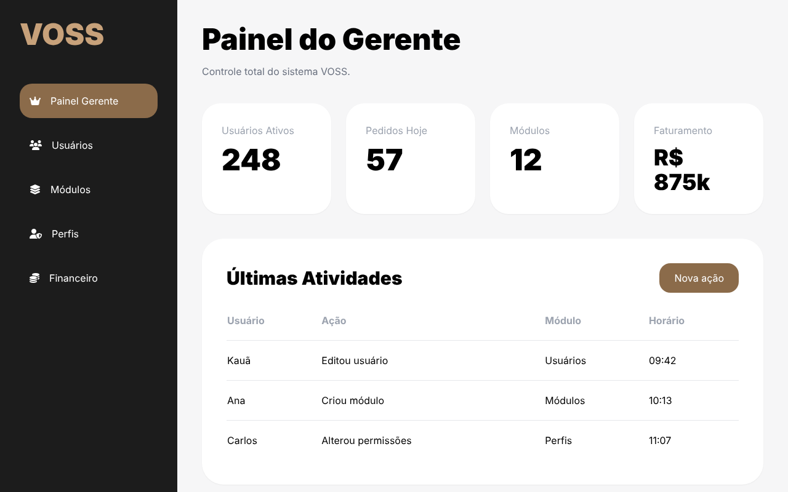
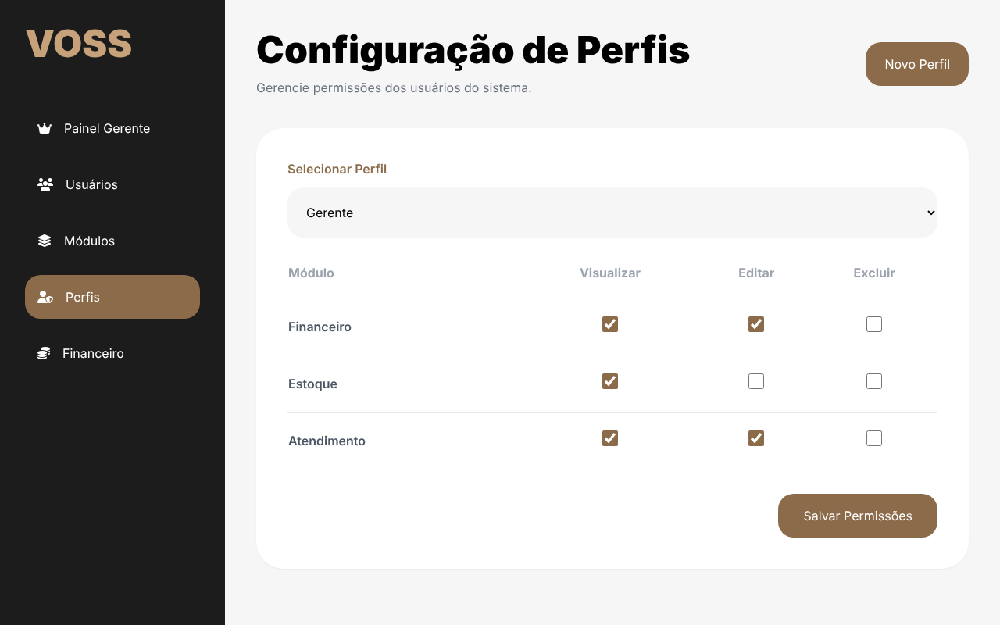
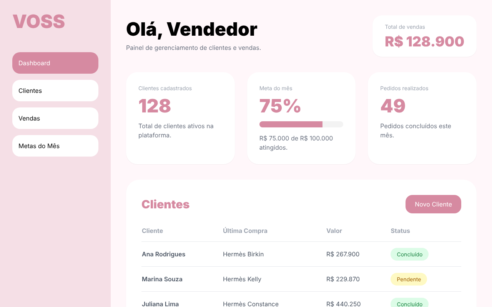
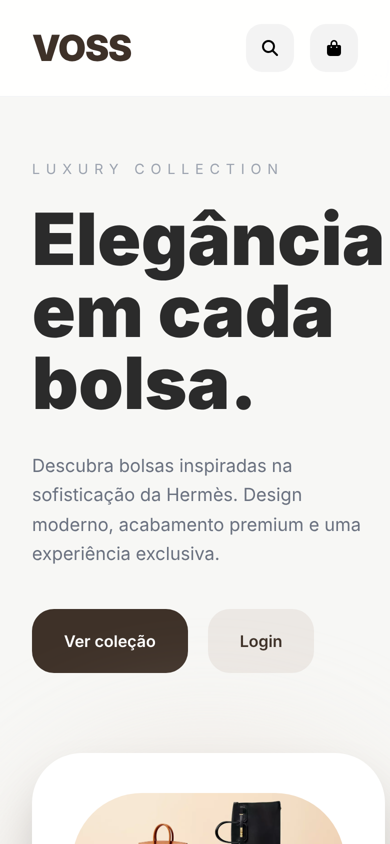

<p align="center">
  
</p>

<h1 align="center">👜 Telas — VOSS Luxury Bags</h1>

<p align="center">
  Protótipo navegável das telas de um sistema para a <b>VOSS</b>, loja fictícia de bolsas de luxo: vitrine,
  coleção, produto, carrinho, login por perfil e painéis internos de gerente, administrador, vendedor e atendente.
</p>

<p align="center">
  
  
  
  
</p>

<p align="center">
  <a href="#-sobre-o-projeto">Sobre</a> •
  <a href="#-funcionalidades">Funcionalidades</a> •
  <a href="#-telas">Telas</a> •
  <a href="#-como-executar">Como executar</a> •
  <a href="#-estrutura-do-projeto">Estrutura</a> •
  <a href="#-tecnologias">Tecnologias</a>
</p>

---

## 📌 Sobre o projeto

Conjunto de **21 telas em HTML** que simulam o sistema de uma loja de bolsas de luxo: a parte pública (vitrine,
coleção, produto e carrinho) e as áreas internas de cada perfil de usuário. Os dados exibidos (clientes, vendas,
metas, valores) são fixos no HTML ou gerados no navegador, apenas para demonstração; não há back-end.

## ✨ Funcionalidades

| | Recurso | Descrição |
|---|---|---|
| 🛍️ | **Vitrine** | Página inicial da loja com destaque, diferenciais e acesso à coleção e ao login |
| 👜 | **Coleção** | 45 bolsas geradas por JavaScript, com preços sorteados a cada carregamento |
| 🏷️ | **Produto e carrinho** | `produto.html?id=1` (a 3) mostra o produto; "Adicionar ao Carrinho" grava no `localStorage` e o carrinho lista e remove itens |
| 🔐 | **Login por perfil** | Contas de demonstração levam ao painel de cada perfil (veja abaixo) |
| 📝 | **Cadastro de cliente** | Formulário de criação de conta |
| 📊 | **Painel do gerente** | Indicadores, últimas atividades e menu de usuários, módulos, perfis e financeiro |
| 🧩 | **Perfis e permissões** | Tabela de permissões (visualizar, editar, excluir) por módulo |
| 💼 | **Área do vendedor** | Dashboard, clientes, vendas e metas do mês |
| 🛠️ | **Admin e atendente** | Painéis próprios com os acessos de cada perfil |

### 🔑 Contas de demonstração (`login.html`)

O login é só uma simulação em JavaScript (sem servidor). Todas usam a senha `123456`:

| E-mail | Vai para |
|---|---|
| `gerente@voss.com` | `dashboard-gerente.html` |
| `admin@voss.com` | `dashboard-admin.html` |
| `vendedor@voss.com` | `dashboard-vendedor.html` |
| `atendente@voss.com` | `dashboard-atendente.html` |
| `cliente@voss.com` | `cliente.html` (página ainda não criada) |

## 🖼️ Telas

<table>
  <tr>
    <td align="center"><b>Vitrine</b><br></td>
    <td align="center"><b>Coleção</b><br></td>
  </tr>
  <tr>
    <td align="center"><b>Produto</b><br></td>
    <td align="center"><b>Login</b><br></td>
  </tr>
  <tr>
    <td align="center"><b>Painel do gerente</b><br></td>
    <td align="center"><b>Perfis e permissões</b><br></td>
  </tr>
  <tr>
    <td align="center"><b>Área do vendedor</b><br></td>
    <td align="center"><b>Celular</b><br></td>
  </tr>
</table>

## 🚀 Como executar

Não há build nem dependências locais:

```bash
git clone https://github.com/kauaxp77/Telas.git
cd Telas
```

Depois, abra o `index.html` no navegador. É preciso internet: o Tailwind CSS, o Font Awesome e as imagens são
carregados de CDNs/links externos.

## 📁 Estrutura do projeto

```
Telas/
├── index.html                 # Vitrine da loja
├── colecao.html               # Coleção de bolsas (gerada por JS)
├── produto.html               # Detalhe do produto (?id=1 a 3)
├── carrinho.html              # Carrinho (localStorage)
├── login.html                 # Login com redirecionamento por perfil
├── cadastro-cliente.html      # Criação de conta
├── dashboard-gerente.html     # Painel do gerente
├── gerente.html               # Painel do gerente (indicadores e atividades)
├── painel.html                # Painel geral
├── usuarios.html              # Configuração de usuários
├── modulos.html               # Configuração de módulos
├── perfis.html                # Perfis e permissões
├── financeiro.html            # Financeiro
├── interface.html             # Painel administrativo (usuários e módulos)
├── dashboard-admin.html       # Painel do administrador
├── dashboard-atendente.html   # Painel do atendente
├── dashboard-vendedor.html    # Área do vendedor
├── painel-vendedor.html       # Dashboard do vendedor
├── clientes.html              # Clientes do vendedor
├── vendas.html                # Vendas do vendedor
├── metas.html                 # Meta do mês
└── docs/
    ├── banner.png
    └── screenshots/           # Capturas de tela deste README
```

## 🛠️ Tecnologias

- **HTML5**
- **Tailwind CSS** (Play CDN): estilos
- **JavaScript**: coleção, produto, carrinho (`localStorage`) e login simulado
- **Font Awesome 6.5**: ícones

## 👨‍💻 Autor

Desenvolvido por **[kauaxp77](https://github.com/kauaxp77)**.

<p align="center">⭐ Se curtiu o projeto, deixe uma estrela!</p>
